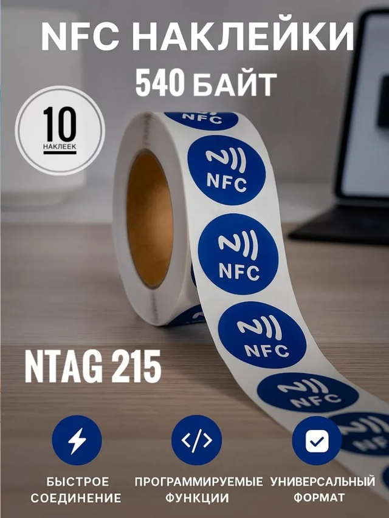

# ESP_TO_SPOOLMAN
Данный проект реализует считывание NFC меток типа NTAG2xx установленных на катушках с филаментом, и установку активной катушки в сервис [Spoolman]([https://github.com/ManuelW77/Filaman](https://github.com/Donkie/Spoolman#integration-status))  через Moonraker. Spoolman должен быть установлен и настроен в вашей сети и принтере.
## Используемые компоненты
1. Контроллер ESP32-C3 super mini
2. Считыватель NFC меток RFID-RC522
3. Светодиод WS2812B
4. Кнопка
5. Метки NTAG215, NTAG216
   
Проект выполнен для ESP32-C3 но можно установить на другой тип ESP32  с заменой пинов на соотвествующие.
Имеется web-интерфейс для настройки wifi и адресов серверов Spoolman и Moonraker. Так же там отображается состояние доступности серверов, считывателя и данные полученные с метки.

## Запись меток
Запись меток осуществляется с помощью проекта [FilaMan](https://github.com/ManuelW77/Filaman)
Метки можно применять такие NTAG215 


## СХЕМА
Схема подключения модуля и ESP32


## Pinout ESP32-C3 super mini


## Работа устройства
При включении ESP создает точку доступа с именем "ESP to Spoolman" и будет мигать синий светодиод к которой необходимо подключиться и перейти по IP 192.168.4.1. В  настройках необходимо ввести данные свой wifi сети, IP адрес сервера Spoolman, и IP адрес сервера Moonraker (ваш принтер с Klipper). И нажать кнопку "Save&Restart". После переподключения должны гореть зеленые светодиоды о доступности серверов и считывателя NFC. При необходимости нажать кнопку "Проверка статуса серверов". Светодиод на устройстве должен гороть зеленым. При поднисении метки к считывателю и успешном считывании метки светодиод мигнет желтым и установиться текущая катушка в web-интерфейсе вашего принтера. В случае ошибки чтения метки светодиод мигнет красным. Если красный горит постоянно значить потеряна связь с сервером или сетью. Подробный вывод ошибок и текущего состояния можно увидеть в логе в web-интерфейсе.

При включении переключателя "Устанавливать в MMU" будет также отправляться на принтер команда MMU_GATE_MAP NEXT_SPOOLID="spool_id". При этом если вы за время указанное в настройках вашего Happy Hare вставите в затвор пруток, то он установиться к карту затворов. Интеграция Happy Hare и Spoolman должна быть включена

## Вид web-интерфейса устройства


## Вид web-интерфейса принтера с установленной катушкой


## Общий вид устройства
Файлы для печати доступны в папке cad

Общий вид устройства в корпусе 


## Прошивка и обновление (OTA)

С v1.3 устройство собирается под кастомной разметкой flash на 4 МБ — два OTA-слота,
поэтому обновление прошивки возможно по сети, без USB. Разметка лежит в
`src/esp32_spoolman/partitions.csv` (обязательно в каталоге скетча: prebuild-hook ядра
копирует её в build path, и она перекрывает разметку из меню платы).

| Раздел | Тип | Смещение | Размер |
|---|---|---|---|
| nvs | data/nvs | 0x009000 | 20 КБ |
| otadata | data/ota | 0x00E000 | 8 КБ |
| app0 | app/ota_0 | 0x010000 | 0x190000 (1.56 МБ) |
| app1 | app/ota_1 | 0x1A0000 | 0x190000 (1.56 МБ) |
| spiffs (LittleFS, настройки) | data/spiffs | 0x330000 | 768 КБ |
| coredump | data/coredump | 0x3F0000 | 64 КБ |

Сборка (те же опции платы, что и раньше, плюс кастомная разметка):

```bash
arduino-cli compile --fqbn esp32:esp32:esp32c3:PartitionScheme=no_ota,CDCOnBoot=cdc \
  --build-property "build.partitions=custom" \
  --build-property "upload.maximum_size=1638400" \
  --build-path /tmp/esp32_spoolman-build src/esp32_spoolman
```

`upload.maximum_size=1638400` (0x190000) — реальный размер OTA-слота. Без него
`PartitionScheme=no_ota` рапортует ложный лимит 2 МБ из меню платы. Текущий образ
занимает 1 370 747 Б (83% слота), запас ~261 КБ; приложение, выросшее за 1.56 МБ,
прошиваться не будет.

### Первый выкат — только по USB

Разметку нельзя сменить по OTA: устройство, прошитое старой таблицей (`no_ota`,
один слот), не найдёт второй OTA-слот. Первая прошивка v1.3 — по USB:

```bash
arduino-cli upload -p /dev/ttyACM0 \
  --fqbn esp32:esp32:esp32c3:PartitionScheme=no_ota,CDCOnBoot=cdc \
  --build-path /tmp/esp32_spoolman-build src/esp32_spoolman
```

В Arduino IDE достаточно выбрать те же опции платы и нажать «Загрузка».

После первой прошивки настройки сбрасываются: раздел LittleFS переехал
(0x210000 → 0x330000), старый `data.db` не читается и создаётся заново. Устройство
снова поднимет точку доступа «ESP to Spoolman» — Wi-Fi, адреса Spoolman/Moonraker
нужно ввести заново.

### Дальнейшие обновления — по OTA

1. Собрать образ той же командой (разметка custom) — нужен только `esp32_spoolman.ino.bin`.
2. Кнопка «Обновить прошивку» в web-интерфейсе устройства (Настройки) — выбрать файл
   `esp32_spoolman.ino.bin`, устройство запишет его во второй слот и перезагрузится.
3. Либо из консоли:

```bash
curl --data-binary @/tmp/esp32_spoolman-build/esp32_spoolman.ino.bin \
  http://<ip-устройства>/ota
```

`/ota` открыт без пароля в локальной сети (осознанный риск для доверенного сегмента).
После перезагрузки устройство стартует с нового слота; при неудачном обновлении
загрузчик остаётся на рабочем образе. Настройки (LittleFS) и NVS при OTA не
затрагиваются — повторная настройка Wi-Fi не требуется. Откат — залить предыдущий
`esp32_spoolman.ino.bin` тем же способом.

## Changelog

### v1.2
- Исправлен критический баг: `PCD_PerformSelfTest()` вызывался в каждом loop(), приводя к нестабильной работе MFRC522. Self-test теперь только при инициализации и в watchdog (30с).
- Исправлен баг поиска spool_id — заменён на прямой запрос `/api/v1/spool/{id}`.
- Убраны множественные `http.end()` в `SetSpool()`.
- Добавлен WiFi auto-reconnect при потере связи (30с).
- Добавлен дебаунс NFC по UID-хешу.
- Добавлен watchdog MFRC522 — self-test каждые 30с, при зависании аппаратный сброс.
- Защита от HTTP-блокировок: `setTimeout(1500)` + retry-delay 30с.
- Logger пишет только при смене состояния сервера или смене катушки.
- LED переработан: `updateLED()` каждый loop().
- FastLED заменён на Adafruit NeoPixel. Для ESP32-C3: `PartitionScheme=no_ota`.
- USB Serial: `CDCOnBoot=cdc`.
- Явно заданы SPI-пины для RC522 под ESP32-C3.
- Реструктуризация проекта: `.ino` + `.h` + `.cpp` — обход бага GTL.h.

