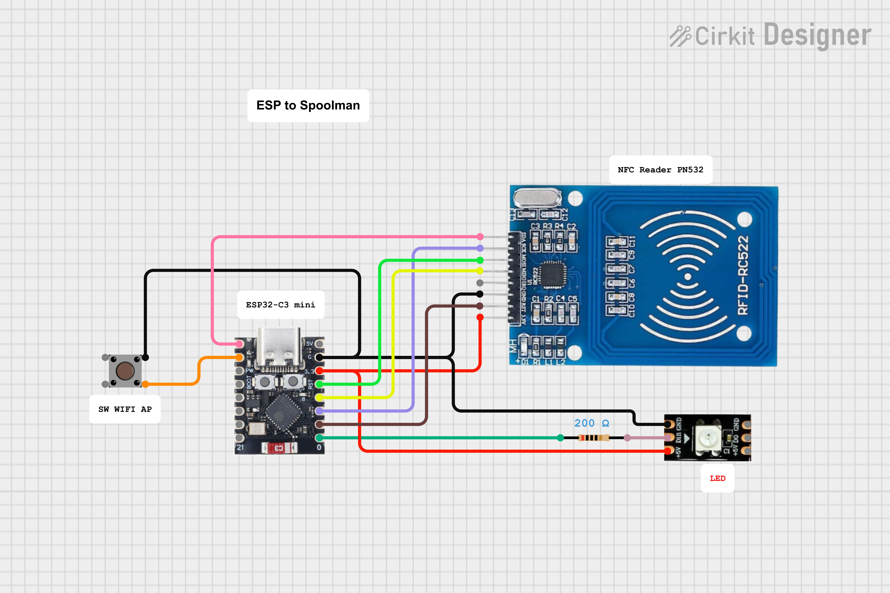
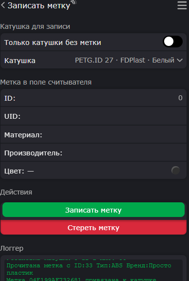
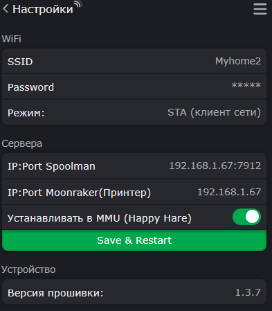
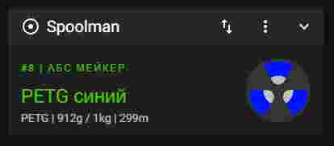
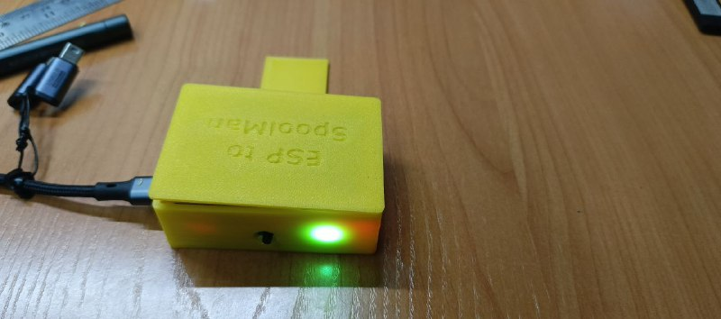
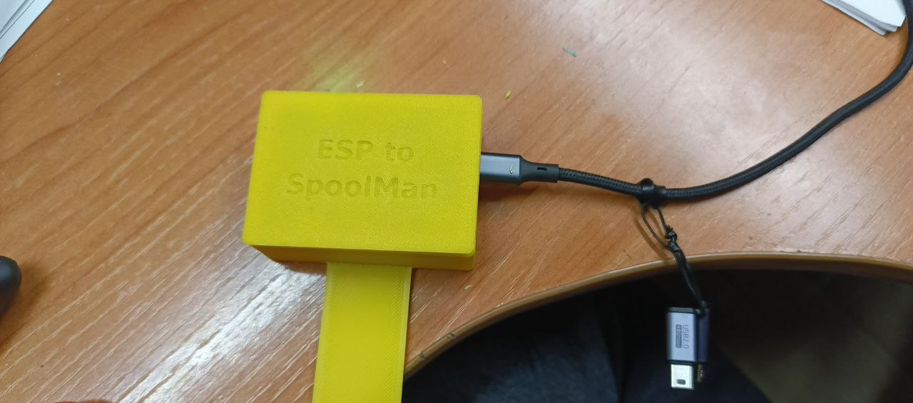
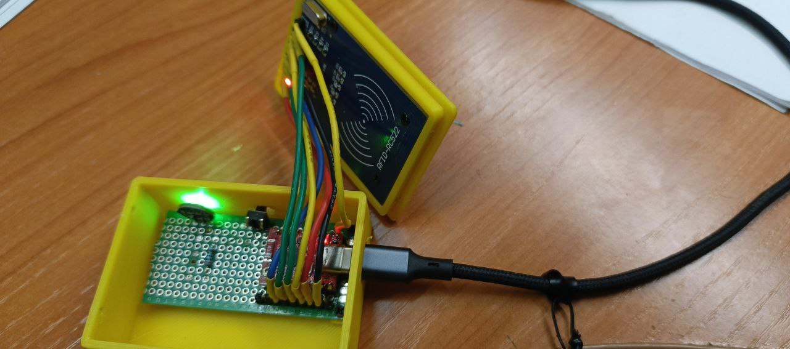

# ESP_TO_SPOOLMAN

NFC-сканер катушек с филаментом: устройство читает метку NTAG, находит катушку в
[Spoolman](https://github.com/Donkie/Spoolman) и устанавливает её активной на принтере через
Moonraker (опционально — с выбором гейта в Happy Hare MMU). Запись и стирание меток выполняются
самим устройством через web-интерфейс — без сторонних приложений.

**Формат меток — OpenSpool** (`application/json`, `protocol: "openspool"`). FilaMan выбыл
(перешёл на платную модель) и не используется: старые FilaMan-метки ещё читаются
(`sm_id` как фолбэк), но при перезаписи метка полностью переписывается в openspool
данными из Spoolman.

## Используемые компоненты

1. Контроллер ESP32-C3 super mini
2. Считыватель NFC RFID-RC522
3. Светодиод WS2812B
4. Кнопка
5. Метки NTAG215, NTAG216 (с открытой записью — без установленных lock-бит)

Проект выполнен для ESP32-C3, но можно установить на другой тип ESP32 с заменой пинов на
соответствующие. Требуется Spoolman **v0.27+** (Tag API) в локальной сети; для MMU — принтер
с Klipper/Moonraker и интеграцией Happy Hare + Spoolman.

Web-интерфейс (меню на библиотеке SettingsGyver): настройка Wi-Fi и адресов серверов, состояние
серверов и считывателя, выбор катушки для записи (со фильтром «без метки»), лог событий, лог-файл
сессии, обновление прошивки по OTA.

## Формат меток и линковка

- **На чипе** — NDEF-запись `application/json` в формате OpenSpool: `type`, `brand`,
  `color_hex`, `min/max_temp`, `bed_min/max_temp`, `spool_id`, `subtype`. Запись всегда
  собирается **заново из данных Spoolman** (GET `/api/v1/spool/{id}` → material, vendor,
  цвет, температуры): содержимое старой метки используется только для лога «что было».
  `subtype` берётся из extra-поля филамента `subtype` (если поле в Spoolman не зарегистрировано,
  пишется `Basic`; регистрация — без перепрошивки: `POST /api/v1/field/filament/subtype`).
- **В Spoolman** — UID метки линкуется к катушке через Tag API (`POST /api/v1/spool/{id}/tag`),
  дополнительно UID сохраняется в extra-поле катушки `card_uids`.
- **Чтение — UID-first**: `POST /api/v1/tag/scan` → `matched_spool_id` → установка катушки;
  фолбэк — содержимое метки (openspool `spool_id`, затем legacy FilaMan `sm_id`).
  Приоритет линковки в Spoolman: содержимое метки может быть застрявшим от прошлой жизни.
- Перед записью проверяются lock-биты (статические стр. 2, динамические стр. 130/226 + PROT):
  запертая метка read-only, запись в неё невозможна. После любой ошибки чтения страницы —
  переселекция метки (обход NAK-состояния MFRC522).

## Запись и стирание меток (v1.3+)

В меню «Записать метку»: список всех катушек из Spoolman (группы по материалу, чекбокс-фильтр
«без метки»), поля читаемой метки (ID/UID/материал/производитель, свотч цвета), кнопки
«Записать метку» и «Стереть метку» с ожиданием касания 60 с.

- В режиме записи/стирания **активация катушки заблокирована** — случайное касание не прерывает
  печать и не переключает катушку.
- Запись = очистка TLV + NDEF + автолинковка UID (Tag API + `card_uids`). Если UID уже
  залинкован к другой катушке — подтверждение в вебморде (видимая красная кнопка), затем
  перелинковка: UID снимается со старых держателей.
- Стирание = зачистка чипа (страницы нулями, TLV `03 00 FE`) + отвязка UID (`DELETE /tag/{uid}`,
  очистка `card_uids` у всех катушек).
- Отказ Spoolman = отказ записи и линковки (линковка только после подтверждённой записи).

## СХЕМА

Схема подключения модуля и ESP32



## Pinout ESP32-C3 super mini


## Работа устройства

При включении ESP создаёт точку доступа «ESP to Spoolman» с мигающим синим светодиодом —
подключитесь и перейдите на 192.168.4.1. В настройках введите данные Wi-Fi, IP сервера
Spoolman и IP Moonraker (принтер с Klipper), затем «Save&Restart». После переподключения
светодиод должен гореть зелёным (все серверы и считыватель доступны). Кнопка «Проверка
статуса серверов» обновляет состояние вручную.

Светодиод — семантика состояний:

| Индикация | Значение |
|---|---|
| Синий мигает | режим точки доступа |
| Красный горит | нет Wi-Fi / сервер недоступен |
| Синий горит | что-то не готово (настройка не завершена) |
| Зелёный | всё в порядке, ожидание метки |
| Жёлтый 2 с | метка успешно прочитана |
| Жёлтый мигает | режим записи: ожидание касания метки |
| Фиолетовый 2 с | запись/стирание выполнены |
| Красный мигает 2 с | ошибка NFC-операции (чтение/запись/стирание) |

При поднесении метки: катушка устанавливается активной в Spoolman, имя текущего филамента
отображается в вебморде. Ошибка чтения — жёлтый/красный по таблице выше; подробности — в логе
web-интерфейса.

Переключатель «Устанавливать в MMU»: вместе с установкой катушки на принтер отправляется
`MMU_GATE_MAP NEXT_SPOOLID=<id>`. Слоты гейтов берутся из extra-поля катушки `mmu_gate_map`
(обновление раз в 10 с). Интеграция Happy Hare и Spoolman должна быть включена. Если за время,
указанное в настройках Happy Hare, вставить пруток в затвор — гейт установится по карте.

## Вид web-интерфейса устройства

Вебморда состоит из трёх страниц: главная и два пункта меню — «Записать метку» и «Настройки»
(переключение мгновенное, без перезагрузки страницы).

### Главная

Статус-страница: доступность серверов и считывателя, текущая катушка, данные метки, лог.

- **Доступность** — индикаторы Moonraker, Spoolman, NFC-считывателя (жёлтый/зелёный) и кнопка
  «Проверка доступности» (ручное обновление статусов).
- **Текущая катушка, установленная в SpoolMan** — ID и имя филамента активной катушки.
- **MMU Gate** (появляется при включённом «Устанавливать в MMU») — слоты Gate0–Gate3 с катушками,
  обновляются раз в 10 с из extra-поля `mmu_gate_map`.
- **NFC Метка** — ID, UID, материал, производитель и свотч цвета последней прочитанной метки.
- **Логгер** — события сессии (чтения, записи, ошибки).


### «Записать метку»

Меню записи/стирания меток. Пока открыта эта страница, **активация катушки заблокирована** —
касание метки ничего не устанавливает на принтере, печать не прерывается.

- **Катушка для записи** — чекбокс «Только катушки без метки» (фильтр по отсутствию линковки;
  после смены фильтра список перестраивается) и Select «Катушка» — все катушки из Spoolman,
  сгруппированные по материалу.
- **Метка в поле считывателя** — ID, UID, материал, производитель и свотч-кружок цвета метки,
  лежащей на считывателе.
- **Действия**:
  - «Записать метку» — нужен выбранный спул; устройство ждёт касание 60 с (жёлтый мигает),
    затем пишет openspool JSON из данных Spoolman и линкует UID.
  - «Стереть метку» — катушку выбирать не нужно: держатель UID ищется в Spoolman по тегу.
    Стирание зачищает чип и снимает все линковки UID.
  - Если приложена метка, залинкованная к другой катушке, появляются красная кнопка
    «Записать на залинкованную метку (ID N)» и «Отмена» — запись без подтверждения не выполняется.
- **Логгер** — лог операций записи/стирания прямо в этом меню.



### «Настройки»

- **WiFi** — SSID и пароль сети; индикация текущего режима (AP — точка доступа для первичной
  настройки, STA — клиент сети).
- **Сервера** — `IP:Port` Spoolman и `IP:Port Moonraker (принтер)`, переключатель
  «Устанавливать в MMU (Happy Hare)», кнопка «Save & Restart» (сохранить и перезагрузить
  устройство).
- **Устройство** — версия прошивки (используется для проверки после OTA-обновления).



## Вид web-интерфейса принтера с установленной катушкой


## Общий вид устройства
Файлы для печати доступны в папке cad

Общий вид устройства в корпусе





## Прошивка и обновление (OTA)

С v1.3 устройство собирается под кастомной разметкой flash на 4 МБ — два OTA-слота,
поэтому обновление прошивки возможно по сети, без USB. Разметка лежит в
`src/esp32_spoolman/partitions.csv` (обязательно в каталоге скетча: prebuild-hook ядра
копирует её в build path, и она перекрывает разметку из меню платы).

| Раздел | Тип | Смещение | Размер |
|---|---|---|---|
| nvs | data/nvs | 0x009000 | 20 КБ |
| otadata | data/ota | 0x00E000 | 8 КБ |
| app0 | app/ota_0 | 0x010000 | 0x190000 (1.56 МБ) |
| app1 | app/ota_1 | 0x1A0000 | 0x190000 (1.56 МБ) |
| spiffs (LittleFS, настройки) | data/spiffs | 0x330000 | 768 КБ |
| coredump | data/coredump | 0x3F0000 | 64 КБ |

Сборка релиза — один скрипт, в `build/` остаются ровно два файла с версией в имени:

```bash
./scripts/package_build.sh
# build/esp32_spoolman_v<VER>_full.bin   полная прошивка (USB, write_flash 0x0)
# build/esp32_spoolman_v<VER>_ota.bin    образ приложения для OTA
```

Готовые бинарники в git не входят — они прикладываются к GitHub Releases тега
`v<VER>` (`gh release create v<VER> build/*.bin`); для OTA из веб-морды скачайте
`esp32_spoolman_v<VER>_ota.bin` со страницы релиза.

### Зависимости

Версии ядра и библиотек зафиксированы — сборка воспроизводима; CI собирает ровно
на них (`.github/workflows/ci.yml`):

| | Версия |
|---|---|
| esp32 core (arduino-cli) | 3.3.10 |
| RFID_MFRC522v2 | 2.0.6 |
| Settings (SettingsGyver) | 1.3.17 |
| GyverDB (GyverDBFile) | 1.4.4 |
| TimerMs | 1.2 |
| Adafruit NeoPixel | 1.15.5 |
| ArduinoJson | 7.4.2 |
| BSON (зависимость Settings) | 2.3.5 |

Обновление библиотеки Settings сломает локальный CSS-патч фронтенда (см. ниже) —
после обновления перепроверять вид по `build()` и накладывать патч заново.

Версия берётся из `src/esp32_spoolman/esp32_spoolman.h` (`VER`), промежуточные
артефакты arduino-cli лежат в `.build/` и в git не попадают. Эквивалент вручную:

```bash
arduino-cli compile --fqbn esp32:esp32:esp32c3:PartitionScheme=no_ota,CDCOnBoot=cdc \
  --build-property "build.partitions=custom" \
  --build-property "upload.maximum_size=1638400" \
  --build-path .build src/esp32_spoolman
```

`upload.maximum_size=1638400` (0x190000) — реальный размер OTA-слота. Без него
`PartitionScheme=no_ota` рапортует ложный лимит 2 МБ из меню платы. Текущий образ
(v1.3.12) занимает 1 401 945 Б (~85% слота), запас ~230 КБ; приложение, выросшее
за 1.56 МБ, прошиваться не будет.

### Первый выкат — только по USB

Разметку нельзя сменить по OTA: устройство, прошитое старой таблицей (`no_ota`,
один слот), не найдёт второй OTA-слот. Первая прошивка v1.3 — по USB:

```bash
arduino-cli upload -p /dev/ttyACM0 \
  --fqbn esp32:esp32:esp32c3:PartitionScheme=no_ota,CDCOnBoot=cdc \
  --build-path .build src/esp32_spoolman
# либо напрямую полной прошивкой:
esptool.py --chip esp32c3 -p /dev/ttyACM0 write_flash 0x0 build/esp32_spoolman_v<VER>_full.bin
```

В Arduino IDE достаточно выбрать те же опции платы и нажать «Загрузка».

После первой прошивки настройки сбрасываются: раздел LittleFS переехал
(0x210000 → 0x330000), старый `data.db` не читается и создаётся заново. Устройство
снова поднимет точку доступа «ESP to Spoolman» — Wi-Fi, адреса Spoolman/Moonraker
нужно ввести заново.

### Дальнейшие обновления — по OTA

1. Собрать релиз: `./scripts/package_build.sh` — нужен файл `build/esp32_spoolman_v<VER>_ota.bin`.
2. Кнопка «Обновить прошивку» в web-интерфейсе устройства (Настройки) — выбрать этот файл,
   устройство запишет его во второй слот и перезагрузится.
3. Либо из консоли:

```bash
curl --data-binary @build/esp32_spoolman_v<VER>_ota.bin \
  http://<ip-устройства>/ota
```

`/ota` открыт без пароля в локальной сети (осознанный риск для доверенного сегмента).
После перезагрузки устройство стартует с нового слота; при неудачном обновлении
загрузчик остаётся на рабочем образе. Настройки (LittleFS) и NVS при OTA не
затрагиваются — повторная настройка Wi-Fi не требуется. Откат — залить предыдущий
`esp32_spoolman_v<VER>_ota.bin` тем же способом.

## Локальный патч библиотеки Settings (шрифт групп) — v1.3.2

Фронтенд веб-интерфейса (HTML/CSS/JS) лежит не в скетче, а в библиотеке Settings:
`/root/Arduino/libraries/Settings/src/web/settings.h` — gzip-массивы в PROGMEM
(`settings_index_gz`, `settings_script_gz`, `settings_style_gz`, `settings_favicon_gz`),
которые отдаются браузеру как есть (с `Content-Encoding: gzip`). Из скетча размер шрифта групп
и опций не настраивается, поэтому CSS патчится локально:

| Правило | Было (поставка 1.3.16) | Стало |
|---|---|---|
| `.select .title` (заголовок группы в диалоге Select) | `font-size:14px`, обычный | `font-size:16px; font-weight:600` |
| `.option` (опция списка) | `font-size:18px` | `font-size:15px; font-weight:400` |

**Патч живёт только в установленной библиотеке и слетает при её обновлении**
(SettingsGyver обновился / библиотеки переустанавливались) — тогда шрифт вернётся к
поставочному, ошибки не будет, просто вид станет прежним.

Переприменить: `python3 workflows/t_0166b8c0/patch_settings_css.py` — распаковывает
`settings_style_gz`, правит два правила, пакует обратно, пересобирает C-массив и проверяет
декомпрессию; повторный запуск ничего не меняет (идемпотентен), `--check` только проверяет
наличие патча. Скрипт сам скажет, если в новой версии библиотеки правила переименованы
(не найдено ни исходного, ни патченного варианта).

## Changelog

### v1.3.12
- Регрессия v1.3.10: `String(F("status"))` в loop() конструировался на каждом проходе —
  malloc/free десятки тысяч раз в секунду, фрагментация кучи, перемежающиеся отказы
  HTTP/JSON/чтения. Сравнение с литералом без аллокации.

### v1.3.11
- Регрессия оптимизации reload (1.3.9): в `statusServer` перерисовка шлась только при смене
  `spool_id` — флип `spoolman_connected` при том же ID оставлял LED_MN в веб-морде устаревшим.
  Reload теперь и при смене связи (`wasOk != spoolman_connected`).

### v1.3.10
- Дедуп касаний — FNV-1a по всем байтам UID: старый хеш-сдвиг оставлял только последние
  4 байта, две 7/10-байтовые метки с совпадающим хвостом считались одной и касание второй
  молча пропускалось.
- Serial-команды читаются построчно без блокировки loop: `readString()` ждал таймаут
  (до 1 с) на каждой команде. Команда `status` и номер катушки работают как раньше.
- CI поднят из шаблона: реальная `arduino-cli compile` с зафиксированными версиями
  ядра и библиотек (раздел «Зависимости»); версия ядра/библиотек == локальной сборке.
- Гигиена: `or`/`and` → `||`/`&&`; в AGENTS.md помечены внутренние пути, битые для
  внешнего контрибьютора.

### v1.3.9
- Опрос серверов разрежен 500 мс → 3 с (отдельный таймер `T_SERVERS`): раньше каждые полсекунды
  уходило два блокирующих HTTP-запроса (Moonraker + Spoolman), при медленном сервере loop
  блокировался дольше периода. Экс-`T_LED_WIFI` переименован в `T_LED_AP` — он только для
  мигания синим в AP-режиме. `sett.reload()` теперь только при изменении отображаемого
  (ID/имя катушки, доступность серверов), а не каждый тик.
- HTTP-успех — только 200: 404/500 в `statusServer`/`curent_filament_name` раньше красили
  индикатор в «сервер доступен». Без активной катушки `/api/v1/spool/0` не опрашивается
  (раньше — 404 каждый тик при зелёном LED).
- `ARDUINOJSON_USE_DOUBLE 0` перенесён выше include — объявление после `#include <ArduinoJson.h>`
  не действовало.
- Удалён мёртвый `WiFiServer server(80)` (`begin()` без единого `available()` — конфликт порта
  с веб-мордой Settings).

### v1.3.8
- Восстановление усиления приёмника MFRC522 после самотеста (`restoreReaderConfig`): самотест
  (boot, watchdog раз в 30 с, reset) завершается `PCD_Init()` и сбрасывает RxGain с выставленного
  0x70 (48 дБ) в дефолт 0x40 (33 дБ) — раньше деградация только логировалась (D22), и ридер
  работал на пониженной чувствительности постоянно.
- Единый таймаут bulk-GET списка катушек `BULK_HTTP_TIMEOUT_MS` (10 с) для всех трёх потребителей
  (`fetchSpoolList`, `updateMmuGates`, `spoolsByCardUid`) — раньше два из них оставались на 1.5–2 с
  и на большой библиотеке получали обрыв ответа («ошибка разбора» / «ответ не разобран»).

### v1.3.7
- Исправлено зависание без подключённого терминала: `Serial.setTxTimeoutMs(0)` — при воткнутом
  USB без читающего терминала TX-ring CDC переполнялся, каждый `Serial.println` блокировал
  loop до ~2 с; чтение меток растягивалось до 25-30 с, HTTP упирался в таймауты («обрыв связи»).
  Лишний Serial-вывод теперь отбрасывается, файловый лог пишет всё.

### v1.3.6
- Перезапись метки — всегда полными данными из Spoolman (`readSpoolForTag` → `buildOpenspoolJSON`):
  вендорский режим «дописать spool_id в существующий JSON» удалён (метка расходилась с базой
  при смене пластика/производителя).
- `subtype` в метку — из зарегистрированного extra-поля филамента `subtype` (фолбэк `Basic`),
  вместо парсинга имени.

### v1.3.5
- При линковке/стирании UID снимается со всех катушек-держателей `card_uids` (устранение
  «застрявших» линковок).
- Bulk-запрос списка катушек: таймаут 10 с + диагностическая строка (байты/мс/найдено).
- Пустой `card_uids` сериализуется как `""` — Spoolman отвечает 400 на пустое значение extra.

### v1.3.4
- Таймауты ожидания метки в режимах записи/стирания; дедуп касаний по временному гэпу
  (одиночный пропуск WUPA не перезапускает таймеры).
- Видимые кнопки подтверждения записи залинкованной метки.
- Стирание снимает `card_uids` независимо от владельца линковки (tag/scan).

### v1.3.3
- Линковка UID в extra-поле катушки `card_uids` (в дополнение к Tag API).
- Слоты MMU-гейтов из extra `mmu_gate_map` (обновление раз в 10 с).
- Свотч цвета читаемой метки, семантика светодиода NFC-операций, лог причины загрузки
  (`esp_reset_reason`), файловый лог сессии (`/log.txt` в LittleFS).
- Подтверждение записи залинкованной метки.

### v1.3.2
- Переселекция метки после NAK (обход зависания приёма MFRC522).
- Названия цветов филамента, порядок меню, логгер в меню записи, патч шрифтов фронтенда.

### v1.3.1
- Меню вместо вкладок (SettingsGyver `beginMenu`) — мгновенное переключение.
- Подгруппы в списке катушек, трёхсостояняя проверка lock-битов, линковка после записи,
  удержание пустой метки, NFC-диагностика (ATQA/SAK/CC/пробы страниц).

### v1.3
- **Переход на OpenSpool**: NDEF-парсер + запись меток самим устройством. FilaMan выбыл
  (платная модель) — запись через него удалена; его старые метки читаются (`sm_id`-фолбэк).
- Чтение UID-first через Spoolman Tag API (`POST /api/v1/tag/scan`, требует Spoolman v0.27+).
- Меню записи/стирания меток с блокировкой активации катушки.
- Стирание = зачистка чипа + отвязка UID.
- Кастомная OTA-разметка flash (два слота) — обновление по сети.

### v1.2
- Исправлен критический баг: `PCD_PerformSelfTest()` вызывался в каждом loop(), приводя к нестабильной работе MFRC522. Self-test теперь только при инициализации и в watchdog (30с).
- Исправлен баг поиска spool_id — заменён на прямой запрос `/api/v1/spool/{id}`.
- Убраны множественные `http.end()` в `SetSpool()`.
- Добавлен WiFi auto-reconnect при потере связи (30с).
- Добавлен дебаунс NFC по UID-хешу.
- Добавлен watchdog MFRC522 — self-test каждые 30с, при зависании аппаратный сброс.
- Защита от HTTP-блокировок: `setTimeout(1500)` + retry-delay 30с.
- Logger пишет только при смене состояния сервера или смене катушки.
- LED переработан: `updateLED()` каждый loop().
- FastLED заменён на Adafruit NeoPixel. Для ESP32-C3: `PartitionScheme=no_ota`.
- USB Serial: `CDCOnBoot=cdc`.
- Явно заданы SPI-пины для RC522 под ESP32-C3.
- Реструктуризация проекта: `.ino` + `.h` + `.cpp` — обход бага GTL.h.
